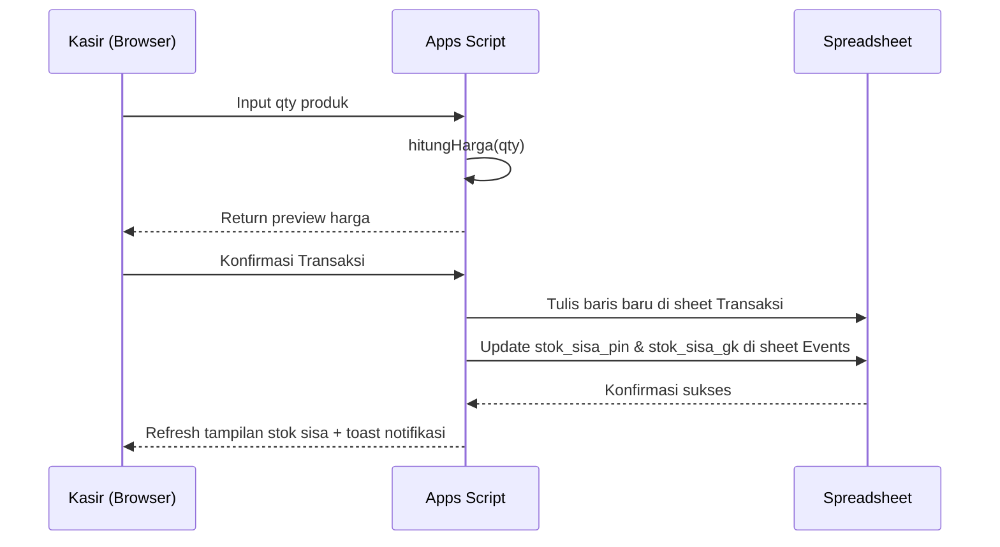
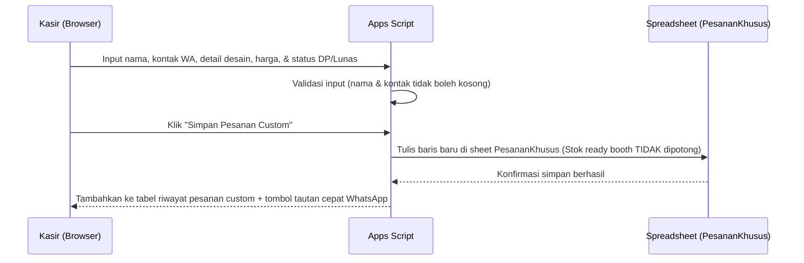
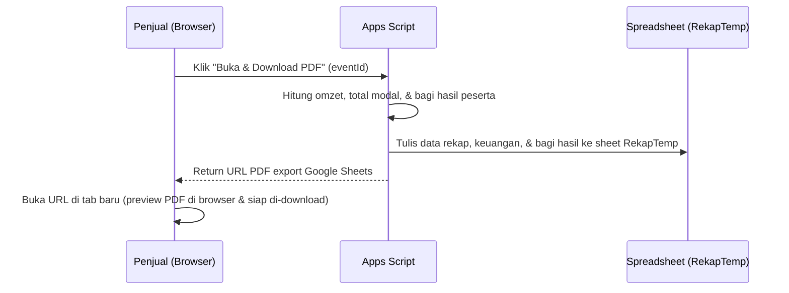

# 🏗️ System Architecture Document (SAD)
## Sistem Manajemen Penjualan Event — PinTrack

**Versi:** 1.1  
**Tanggal:** 11 November 2026  
**Author:** —  
**Status:** Approved / In Development

---

## 1. Gambaran Arsitektur Sistem

PinTrack dibangun di atas ekosistem **Google Workspace** dengan komponen utama:

```
┌─────────────────────────────────────────────────┐
│                   BROWSER / CLIENT               │
│   (Smartphone / PC via Google Apps Script URL)   │
└───────────────────┬─────────────────────────────┘
                    │ HTTPS
                    ▼
┌─────────────────────────────────────────────────┐
│          GOOGLE APPS SCRIPT (GAS)                │
│  ┌──────────────┐    ┌────────────────────────┐  │
│  │  HTML Service│    │   Server-side Scripts   │  │
│  │  (UI Layer)  │◄──►│  (Business Logic Layer) │  │
│  └──────────────┘    └───────────┬────────────┘  │
└──────────────────────────────────┼───────────────┘
                                   │ SpreadsheetApp API
                                   ▼
┌─────────────────────────────────────────────────────────────┐
│                GOOGLE SPREADSHEET (Database)                │
│  ┌──────────┐ ┌──────────┐ ┌───────────────┐ ┌────────────┐ │
│  │  Events  │ │Transaksi │ │ PesananKhusus │ │ Pengaturan │ │
│  │  Sheet   │ │  Sheet   │ │ (Custom Order)│ │   Sheet    │ │
│  └──────────┘ └──────────┘ └───────────────┘ └────────────┘ │
└─────────────────────────────────────────────────────────────┘
```

---

## 2. Arsitektur Deployment

| Komponen | Teknologi | Keterangan |
|---|---|---|
| **Frontend UI** | Google Apps Script HTML Service | Halaman web di-serve via GAS Web App URL |
| **Backend Logic** | Google Apps Script (`.gs`) | Server-side JavaScript untuk CRUD & kalkulasi |
| **Database** | Google Spreadsheet | Penyimpanan data persisten |
| **Export PDF** | GAS `DriveApp` + `Blob` | Generate PDF dari Spreadsheet |
| **Hosting** | Google Cloud (via GAS) | Deploy sebagai Web App, akses via URL unik |

---

## 3. Struktur File & Folder Project

```
PinTrack (Google Apps Script Project)
│
├── 📄 Code.gs                  ← Entry point, router, Web App handler
├── 📄 Database.gs              ← Semua fungsi baca/tulis ke Spreadsheet
├── 📄 PriceCalc.gs             ← Logika kalkulasi harga
├── 📄 PdfExport.gs             ← Fungsi generate & download PDF
│
├── 📄 dashboard.html           ← UI Halaman Dashboard
├── 📄 planning.html            ← UI Halaman Planning
├── 📄 counting.html            ← UI Halaman Counting
├── 📄 rekap.html               ← UI Halaman Rekap
├── 📄 settings.html            ← UI Halaman Pengaturan
│
└── 📄 styles.html              ← CSS bersama (di-include via HtmlService)
```

---

## 4. Desain Database (Google Spreadsheet)

### Sheet 1: `Events`

| Kolom | Nama Field | Tipe Data | Keterangan |
|---|---|---|---|
| A | event_id | String | UUID auto-generate |
| B | nama_event | String | Nama event |
| C | tanggal_mulai | Date | Format: DD/MM/YYYY |
| D | tanggal_selesai | Date | Format: DD/MM/YYYY |
| E | lokasi | String | Tempat event |
| F | stok_awal_pin | Number | Stok pin awal |
| G | stok_awal_gk | Number | Stok gantungan kunci awal |
| H | stok_sisa_pin | Number | Stok pin tersisa (auto-update) |
| I | stok_sisa_gk | Number | Stok GK tersisa (auto-update) |
| J | status | String | `aktif` / `selesai` / `draft` |
| K | catatan | String | Deskripsi opsional |
| L | modal_pin | Number | Modal biaya per 1 pcs Pin (Rp) |
| M | modal_gk | Number | Modal biaya per 1 pcs Gantungan Kunci (Rp) |
| N | peserta | String | Daftar nama peserta jualan (dipisahkan koma) |
| O | created_at | Timestamp | Waktu pembuatan |

---

### Sheet 2: `Transaksi`

| Kolom | Nama Field | Tipe Data | Keterangan |
|---|---|---|---|
| A | transaksi_id | String | UUID auto-generate |
| B | event_id | String | FK → Events.event_id |
| C | timestamp | Timestamp | Waktu transaksi |
| D | jenis_produk | String | `pin` / `gk` / `campuran` |
| E | qty_pin | Number | Jumlah pin dibeli |
| F | qty_gk | Number | Jumlah GK dibeli |
| G | total_qty | Number | Total semua produk |
| H | total_harga | Number | Nominal Rupiah |
| I | catatan | String | Opsional |

---

### Sheet 3: `Pengaturan`

| Kolom | Nama Field | Tipe Data | Default |
|---|---|---|---|
| A | key | String | — |
| B | value | String/Number | — |

**Rows:**
```
harga_satuan      → 4000
harga_bundel      → 10000
min_bundel        → 3
stok_warning      → 10
```

---

### Sheet 4: `PesananKhusus` (Custom Order / Desain Berbeda)

Digunakan untuk menampung pesanan khusus pengunjung booth yang meminta desain sendiri (made-to-order). Pesanan ini dikelola secara terpisah dan **tidak memotong stok ready** di sheet `Events`.

| Kolom | Nama Field | Tipe Data | Keterangan |
|---|---|---|---|
| A | pesanan_id | String | UUID auto-generate |
| B | event_id | String | FK → Events.event_id |
| C | timestamp | Timestamp | Waktu pencatatan pesanan |
| D | nama_customer | String | Nama lengkap customer |
| E | kontak_customer | String | Nomor WhatsApp / No. HP |
| F | jenis_produk | String | `pin` / `gk` / `campuran` |
| G | qty_pin | Number | Jumlah pin custom |
| H | qty_gk | Number | Jumlah gantungan kunci custom |
| I | total_qty | Number | Total pcs dipesan |
| J | deskripsi_desain | String | Detail rincian permintaan desain / revisi |
| K | link_referensi | String | URL Google Drive / link gambar contoh |
| L | total_harga | Number | Kesepakatan total harga (Rp) |
| M | status_pembayaran | String | `belum_bayar` / `dp` / `lunas` |
| N | nominal_dp | Number | Jumlah uang muka jika memilih DP |
| O | status_pesanan | String | `menunggu_desain` / `diproses` / `siap` / `selesai` / `batal` |
| P | metode_pengambilan | String | `booth` (ambil di booth) / `kurir` / `cod` |
| Q | catatan | String | Alamat pengiriman / catatan kasir |

---

## 5. Desain Halaman & Komponen UI

### 5.1 Layout Umum

Semua halaman menggunakan layout responsif dengan:
- **Navbar** atas: Logo PinTrack + navigasi (Dashboard | Planning | Counting | Rekap | Settings)
- **Main Content Area**: konten halaman spesifik
- **Toast Notification**: notifikasi sukses/error di pojok kanan atas

---

### 5.2 Dashboard

```
┌────────────────────────────────────────┐
│  🎪 PinTrack  [Dashboard][Plan][Count] │  ← Navbar
├────────────────────────────────────────┤
│  📊 EVENT AKTIF: Bazaar UI UX Expo     │
│  ┌──────────┐ ┌──────────┐ ┌────────┐  │
│  │ 📍 Total │ │ 📦 Stok  │ │💰 Omzet│  │
│  │ Event: 5 │ │ Sisa Pin │ │Rp 350k │  │
│  │          │ │   120    │ │        │  │
│  └──────────┘ └──────────┘ └────────┘  │
│                                        │
│  DAFTAR EVENT                          │
│  ┌────────────────────────────────┐    │
│  │ Bazaar UI UX    | Aktif  | 🔗  │    │
│  │ Comic Fest 2026 | Selesai| 🔗  │    │
│  └────────────────────────────────┘    │
│         [+ Buat Event Baru]            │
└────────────────────────────────────────┘
```

---

### 5.3 Planning

```
┌────────────────────────────────────────┐
│  ➕ BUAT / EDIT EVENT                  │
│  ┌────────────────────────────────┐    │
│  │ Nama Event: [____________]     │    │
│  │ Tgl Mulai:  [__/__/____]       │    │
│  │ Tgl Selesai:[__/__/____]       │    │
│  │ Lokasi:     [____________]     │    │
│  ├────────────────────────────────┤    │
│  │ 📌 Stok Pin:         [_____]   │    │
│  │ 🔑 Stok Gantungan:   [_____]   │    │
│  ├────────────────────────────────┤    │
│  │ 💰 Modal per Pcs Pin:  Rp[___] │    │
│  │ 💰 Modal per Pcs GK:   Rp[___] │    │
│  ├────────────────────────────────┤    │
│  │ 👥 Peserta Jualan:             │    │
│  │    [Nama Peserta...] [+Tambah] │    │
│  │    [Budi ✕] [Siti ✕] [Andi ✕]  │    │
│  ├────────────────────────────────┤    │
│  │ 📝 Catatan:          [_____]   │    │
│  └────────────────────────────────┘    │
│         [Simpan Event]                 │
│                                        │
│  DAFTAR EVENT TERENCANA                │
│  ┌────────────────────────────────┐    │
│  │ Event | Tgl | Stok | [✏️][🗑️] │    │
│  └────────────────────────────────┘    │
└────────────────────────────────────────┘
```

---

### 5.4 Counting (Transaksi Reguler & Pesanan Custom)

Halaman Counting menyediakan sub-tab navigasi untuk membedakan antara transaksi langsung produk etalase ready stock dan pesanan pre-order dengan desain berbeda.

```
┌────────────────────────────────────────────────────────┐
│  🎯 EVENT: [Bazaar UI UX Expo 2026 ▼]                  │
│                                                        │
│  [📦 Transaksi Reguler (Ready)]  [🎨 Pesanan Custom]   │
├────────────────────────────────────────────────────────┤
│  === TAB 1: TRANSAKSI REGULER (READY STOCK) ===        │
│                                                        │
│  STOK SISA BOOTH (LIVE)                                │
│  ┌────────────────────────┐  ┌──────────────────────┐  │
│  │  📌 PIN TERSEDIA       │  │ 🔑 GANTUNGAN TERSEDIA│  │
│  │       [ 118 pcs ]      │  │       [ 85 pcs ]     │  │
│  └────────────────────────┘  └──────────────────────┘  │
│                                                        │
│  KASIR TRANSAKSI REGULER                               │
│  ┌──────────────────────────────────────────────────┐  │
│  │ Produk : (•) Pin   ( ) GK   ( ) Campuran         │  │
│  │ Jumlah : [-] [ 3 ] [+]                           │  │
│  │ Total  : Rp 10.000 (Bundel 3 pcs aktif)          │  │
│  └──────────────────────────────────────────────────┘  │
│        [✅ Konfirmasi Transaksi]  [↩️ Batal Terakhir]   │
│                                                        │
│  RIWAYAT TRANSAKSI REGULER HARI INI                    │
│  ┌──────────────────────────────────────────────────┐  │
│  │ 14:23 | Pin×3 | Rp 10.000                        │  │
│  │ 14:19 | GK×1  | Rp  4.000                        │  │
│  └──────────────────────────────────────────────────┘  │
├────────────────────────────────────────────────────────┤
│  === TAB 2: PESANAN DESAIN BERBEDA (CUSTOM ORDER) ===  │
│                                                        │
│  FORMULIR ORDER CUSTOM                                 │
│  ┌──────────────────────────────────────────────────┐  │
│  │ Nama Customer    : [Budi Santoso_______________] │  │
│  │ No. WhatsApp / HP: [081234567890_______________] │  │
│  │ Kategori Produk  : [Pin ▼]    Qty: [ 5 ]         │  │
│  │ Rincian Desain   : [Foto wisuda bertoga, teks:   │  │
│  │                     "Happy Graduation 2026"____] │  │
│  │ Link File/Drive  : [https://drive.google.com/__] │  │
│  │ Kesepakatan Harga: Rp [25.000]                   │  │
│  │ Status Bayar     : ( ) Belum  (•) DP  ( ) Lunas  │  │
│  │   └ Nominal DP   : Rp [10.000]                   │  │
│  │ Pengambilan      : [Ambil di Booth Sebelum Tutup▼│  │
│  │ Catatan / Alamat : [Ambil jam 16:00_____________]│  │
│  └──────────────────────────────────────────────────┘  │
│        [💾 Simpan Pesanan Custom]                      │
│                                                        │
│  DAFTAR PESANAN CUSTOM EVENT INI                       │
│  ┌──────────────────────────────────────────────────┐  │
│  │ # | Customer | Qty | Status Bayar | Status | Aksi│  │
│  │ 1 | Budi S.  | 5Pin| DP 10k/25k   | Menunggu [WA]│  │
│  │ 2 | Siti A.  | 2GK | Lunas 10k    | Diproses [WA]│  │
│  └──────────────────────────────────────────────────┘  │
└────────────────────────────────────────────────────────┘
```

---

### 5.5 Rekap

```
┌────────────────────────────────────────┐
│  📊 REKAP EVENT: [Bazaar UI UX ▼]     │
│                                        │
│  ┌──────────────────────────────────┐  │
│  │          RINGKASAN PENJUALAN     │  │
│  │  Pin   : 120 terjual / 200 awal  │  │
│  │  GK    :  85 terjual / 150 awal  │  │
│  │  Total :  205 pcs terjual        │  │
│  │  Omzet :  Rp 684.000             │  │
│  │  Transaksi: 72 pembeli           │  │
│  │  Sisa Pin: 80 | Sisa GK: 65     │  │
│  └──────────────────────────────────┘  │
│                                        │
│  ┌──────────────────────────────────┐  │
│  │   KALKULASI MODAL & PEMBAGIAN    │  │
│  │  💰 Total Modal     : Rp 250.000 │  │
│  │  📈 Keuntungan Bersih: Rp 434.000 │ │
│  │  👤 Bagian / Orang  : Rp 217.000 │  │
│  │  👥 Daftar Peserta (2 org):      │  │
│  │     1. Budi  → Rp 217.000        │  │
│  │     2. Siti  → Rp 217.000        │  │
│  └──────────────────────────────────┘  │
│                                        │
│    [📄 Buka & Download PDF Rekap]      │  ← Tombol PDF (Tetap Dipertahankan)
│                                        │
│  DETAIL TRANSAKSI                      │
│  ┌────────────────────────────────┐    │
│  │ No | Waktu | Produk | Qty |💰  │    │
│  │  1 | 10:05 | Pin×3  | 3  |10k │    │
│  └────────────────────────────────┘    │
└────────────────────────────────────────┘
```

---

## 6. Arsitektur Backend (Google Apps Script)

### 6.1 `Code.gs` — Router Utama

```javascript
function doGet(e) {
  const page = e.parameter.page || 'dashboard';
  const template = HtmlService.createTemplateFromFile(page);
  return template.evaluate()
    .setTitle('PinTrack')
    .addMetaTag('viewport', 'width=device-width, initial-scale=1');
}

function include(filename) {
  return HtmlService.createHtmlOutputFromFile(filename).getContent();
}
```

---

### 6.2 `Database.gs` — Layer Data

```javascript
// ── EVENTS ──────────────────────────────────────────
function getAllEvents() { ... }
function getEventById(eventId) { ... }
function createEvent(data) { ... }
function updateEvent(eventId, data) { ... }
function deleteEvent(eventId) { ... }
function updateStokSisa(eventId, qtyPin, qtyGk) { ... }

// ── TRANSAKSI ────────────────────────────────────────
function getAllTransaksi(eventId) { ... }
function createTransaksi(data) { ... }
function deleteLastTransaksi(eventId) { ... }   // Undo

// ── PESANAN KHUSUS (CUSTOM ORDER) ────────────────────
function getPesananCustomByEvent(eventId) { ... }
function createPesananCustom(data) { ... }
function updateStatusPesananCustom(pesananId, statusPesanan, statusPembayaran) { ... }
function deletePesananCustom(pesananId) { ... }

// ── PENGATURAN ───────────────────────────────────────
function getSetting(key) { ... }
function updateSetting(key, value) { ... }
```

---

### 6.3 `PriceCalc.gs` — Kalkulasi Harga

```javascript
/**
 * Menghitung total harga berdasarkan aturan bundel
 * Pin dan Gantungan Kunci dihitung sebagai TOTAL QTY bersama
 * @param {number} qtyPin - Jumlah pin
 * @param {number} qtyGk  - Jumlah gantungan kunci
 * @returns {number} - Total harga dalam Rupiah
 */
function hitungHarga(qtyPin = 0, qtyGk = 0) {
  const hargaSatuan = getSetting('harga_satuan'); // 4000
  const hargaBundel = getSetting('harga_bundel'); // 10000
  const minBundel   = getSetting('min_bundel');   // 3

  // Campuran dihitung total — 2 Pin + 1 GK = 3 pcs = Rp10.000
  const totalQty     = qtyPin + qtyGk;
  const jumlahBundel = Math.floor(totalQty / minBundel);
  const sisaBundel   = totalQty % minBundel;

  return (jumlahBundel * hargaBundel) + (sisaBundel * hargaSatuan);
}

// Contoh:
// hitungHarga(2, 1)  → 3 pcs  → Rp 10.000
// hitungHarga(3, 4)  → 7 pcs  → Rp 24.000
// hitungHarga(0, 10) → 10 pcs → Rp 34.000
```

---

### 6.4 `PdfExport.gs` / `RekapLogic.gs` — Export PDF & Pembagian Hasil

```javascript
function exportRekapPDF(eventId) {
  const ss    = SpreadsheetApp.openById(SPREADSHEET_ID);
  const sheet = ss.getSheetByName(SHEET_REKAP_TEMP);

  // 1. Tulis data rekap lengkap ke sheet sementara RekapTemp:
  //    - Ringkasan Penjualan (Stok Awal, Terjual, Stok Sisa)
  //    - Ringkasan Keuangan (Omzet, Total Modal, Keuntungan Bersih)
  //    - Tabel Pembagian Hasil per Peserta Jualan (Keuntungan Bersih / Jumlah Peserta)
  //    - Rincian Riwayat Transaksi
  generateRekapSheet(eventId, sheet);

  // 2. Buat URL export PDF dari sheet tersebut
  const pdfUrl = `https://docs.google.com/spreadsheets/d/${SPREADSHEET_ID}/export`
    + `?format=pdf&gid=${sheet.getSheetId()}&portrait=true&fitw=true&size=A4`;

  // 3. Return URL — frontend membuka URL ini di tab baru
  //    User dapat langsung melihat preview PDF dan download dari browser
  return pdfUrl;
}
```

> **Catatan:** Tombol "Lihat & Download PDF" dipertahankan sepenuhnya. PDF dibuka langsung di tab baru browser menggunakan Google Sheets PDF export URL. Lembar PDF memuat tabel pembagian hasil dan rincian modal.

---

## 7. Alur Data (Data Flow)

### Alur Transaksi Reguler (Counting → Spreadsheet)



---

### Alur Pesanan Desain Berbeda (Custom Order → Spreadsheet)



---

### Alur Export PDF



---

## 8. Konfigurasi & Konstanta

```javascript
// config.gs
const SPREADSHEET_ID        = 'YOUR_SPREADSHEET_ID_HERE';
const SHEET_EVENTS          = 'Events';
const SHEET_TRANSAKSI       = 'Transaksi';
const SHEET_PENGATURAN      = 'Pengaturan';
const SHEET_REKAP_TEMP      = 'RekapTemp';
const SHEET_PESANAN_KHUSUS  = 'PesananKhusus';

const DEFAULT_SETTINGS = {
  harga_satuan : 4000,
  harga_bundel : 10000,
  min_bundel   : 3,
  stok_warning : 10,
};

const HEADERS_EVENTS = [
  'event_id','nama_event','tanggal_mulai','tanggal_selesai',
  'lokasi','stok_awal_pin','stok_awal_gk',
  'stok_sisa_pin','stok_sisa_gk','status','catatan',
  'modal_pin','modal_gk','peserta','created_at'
];

const HEADERS_PESANAN_KHUSUS = [
  'pesanan_id','event_id','timestamp','nama_customer','kontak_customer',
  'jenis_produk','qty_pin','qty_gk','total_qty','deskripsi_desain',
  'link_referensi','total_harga','status_pembayaran','nominal_dp',
  'status_pesanan','metode_pengambilan','catatan'
];
```
```

---

## 9. Keamanan

| Aspek | Implementasi |
|---|---|
| **Autentikasi** | Akses via Google Account pemilik (GAS Web App dengan akses "Only me" atau domain tertentu) |
| **Otorisasi** | Spreadsheet hanya dapat diakses oleh pemilik akun Google |
| **Validasi Input** | Validasi di sisi server (GAS) sebelum data ditulis ke Spreadsheet |
| **Proteksi Sheet** | Sheet `Pengaturan` dan header row diproteksi dari edit manual |

---

## 10. Risiko & Mitigasi

| Risiko | Dampak | Mitigasi |
|---|---|---|
| Koneksi internet putus saat event | Counting tidak bisa dilakukan | Siapkan pencatatan manual backup |
| Quota GAS terlampaui (6 mnt/eksekusi) | Fungsi batch gagal | Pisahkan operasi besar, hindari loop besar |
| **Konflik data multi-user** | — | Single-user by design, tidak ada risiko race condition |
| PDF gagal generate | Rekap tidak bisa dilihat | Fallback: print halaman rekap langsung dari browser |

---

## 11. Tech Stack Summary

```
┌─────────────────────────────────────────┐
│  LAYER          │ TEKNOLOGI              │
├─────────────────┼────────────────────────┤
│ UI / Frontend   │ HTML5, CSS3, JavaScript│
│                 │ Bootstrap / Tailwind   │
├─────────────────┼────────────────────────┤
│ Backend Logic   │ Google Apps Script     │
│                 │ (Server-side JS / V8)  │
├─────────────────┼────────────────────────┤
│ Database        │ Google Spreadsheet     │
│                 │ (via SpreadsheetApp)   │
├─────────────────┼────────────────────────┤
│ File Storage    │ Google Drive           │
│                 │ (PDF export)           │
├─────────────────┼────────────────────────┤
│ Hosting / CDN   │ Google Cloud           │
│                 │ (via GAS Web App URL)  │
└─────────────────┴────────────────────────┘
```
