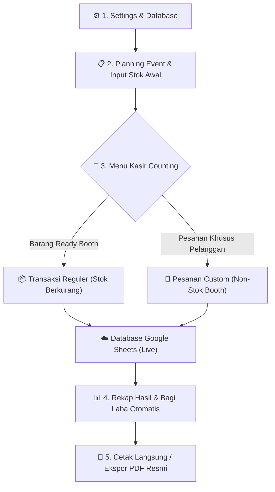

# 📘 BUKU PANDUAN PENGGUNAAN & LAPORAN SISTEM PINTRACK POS
**Sistem Point of Sale (POS), Manajemen Stok Bazaar, dan Rekapitulasi Laba Otomatis Berbasis Google Apps Script & Google Sheets**

---

## 📑 DAFTAR ISI
1. [Tentang Sistem PinTrack POS](#1-tentang-sistem-pintrack-pos)
2. [Arsitektur & Alur Kerja Sistem](#2-arsitektur--alur-kerja-sistem)
3. [Panduan Langkah Demi Langkah (Step-by-Step)](#3-panduan-langkah-demi-langkah-step-by-step)
   - [Langkah 1: Setup Awal & Konfigurasi Tarif (Menu Settings)](#langkah-1-setup-awal--konfigurasi-tarif-menu-settings)
   - [Langkah 2: Perencanaan Event & Alokasi Stok (Menu Planning)](#langkah-2-perencanaan-event--alokasi-stok-menu-planning)
   - [Langkah 3: Operasional Kasir Transaksi Reguler (Menu Kasir Counting)](#langkah-3-operasional-kasir-transaksi-reguler-menu-kasir-counting)
   - [Langkah 4: Pencatatan Pesanan Custom Made-to-Order](#langkah-4-pencatatan-pesanan-custom-made-to-order)
   - [Langkah 5: Monitoring Laporan & Rekapitulasi Hasil (Menu Rekap)](#langkah-5-monitoring-laporan--rekapitulasi-hasil-menu-rekap)
   - [Langkah 6: Ekspor & Cetak Laporan PDF Resmi](#langkah-6-ekspor--cetak-laporan-pdf-resmi)
4. [Logika Kalkulasi & Aturan Bisnis](#4-logika-kalkulasi--aturan-bisnis)
5. [Struktur Database Spreadsheet](#5-struktur-database-spreadsheet)
6. [Tanya Jawab & Troubleshooting (FAQ)](#6-tanya-jawab--troubleshooting-faq)

---

## 1. Tentang Sistem PinTrack POS

**PinTrack POS** adalah aplikasi kasir pintar berbasis web (*Single Page Application*) yang dirancang khusus untuk operasional penjualan merchandise (Pin & Gantungan Kunci/GK) pada stan bazaar, pameran UMKM, festival, dan pop-up booth.

### 🌟 Keunggulan Utama Sistem:
- **Kalkulasi Bundel Otomatis (0ms Response)**: Menghitung otomatis tarif diskon paket hemat (1 pcs = Rp 4.000, 3 pcs = Rp 10.000, berlaku kelipatan dan kombinasi campuran).
- **One-Touch Quick Combos**: Transaksi instan dalam 1 kali sentuhan layar untuk paket-paket yang paling laris.
- **Dua Jalur Penjualan (Ready Stock vs Made-to-Order)**: Memisahkan stok fisik di booth dengan pesanan custom desain pelanggan sehingga stok booth tidak bocor/selisih.
- **Safe Undo Protection**: Fitur pembatalan transaksi terakhir yang aman mengembalikan kuota stok ke event jika kasir salah input.
- **Sinkronisasi Otomatis Google Sheets**: Seluruh data tersimpan terpusat di cloud Google Sheets tanpa memerlukan server database berbayar.
- **Bagi Hasil (Profit Sharing) Otomatis**: Menghitung laba bersih (Omzet dikurangi Modal Pokok/HPP) dan langsung membaginya rata ke seluruh anggota panitia/peserta.

---

## 2. Arsitektur & Alur Kerja Sistem

---

## 3. Panduan Langkah Demi Langkah (Step-by-Step)

### LANGKAH 1: Setup Awal & Konfigurasi Tarif (Menu Settings)

Sebelum memulai penjualan, lakukan pengecekan pengaturan sistem untuk memastikan tarif dan database siap digunakan:

1. Klik menu **Settings** pada navigasi sidebar kiri (atau ikon roda gigi).
2. Periksa parameter harga standar:
   - **Harga Satuan**: Nilai default `Rp 4.000`.
   - **Minimal Jumlah Bundel**: Nilai default `3` pcs.
   - **Harga Bundel**: Nilai default `Rp 10.000`.
   - **Batas Peringatan Stok Menipis**: Nilai default `10` pcs (kartu stok akan berubah warna menjadi kuning/oranye bila sisa stok ≤ angka ini).
3. Jika mengubah parameter, klik tombol **Simpan Pengaturan**.
4. Pada bagian **Inisialisasi & Migrasi Database**:
   - Jika spreadsheet baru pertama kali dibuat, klik **Setup Database Lengkap** untuk membuat otomatis seluruh sheet (`Events`, `Transaksi`, `PesananCustom`, `Settings`, `RekapTemp`).

> [!NOTE]
> Pengaturan tarif ini akan menjadi acuan kalkulator kasir di seluruh transaksi reguler dan saran tarif pada pesanan custom.

---

### LANGKAH 2: Perencanaan Event & Alokasi Stok (Menu Planning)

Setiap bazaar atau pameran baru **harus didaftarkan terlebih dahulu** agar kasir memiliki wadah pencatatan:

1. Buka menu **Planning & Stok** pada sidebar.
2. Isi formulir **Buat Event Baru**:
   - **Nama Event**: Contoh: `Bazaar Kampus Fest 2026` atau `Anime Expo Booth A3`.
   - **Lokasi Bazaar**: Contoh: `Hall B JIExpo Kemayoran`.
   - **Tanggal Mulai & Tanggal Selesai**: Pilih rentang jadwal pelaksanaan event.
   - **Stok Awal PIN (pcs)**: Masukkan jumlah stok fisik PIN yang dibawa ke booth (contoh: `100`).
   - **Stok Awal GK (pcs)**: Masukkan jumlah fisik Gantungan Kunci yang dibawa (contoh: `100`).
   - **Harga Modal PIN / pcs (HPP)**: Biaya produksi per PIN (contoh: `1500`).
   - **Harga Modal GK / pcs (HPP)**: Biaya produksi per GK (contoh: `1800`).
   - **Daftar Anggota / Peserta Jualan**: Masukkan nama panitia/anggota yang berhak atas bagi hasil, dipisahkan dengan tanda koma (contoh: `Farid, Budi, Siti, Rian`).
   - **Catatan Tambahan**: Informasi target penjualan atau nomor kontak stan.
3. Klik tombol **Simpan Rencana Event**.
4. Pastikan status event berada dalam kondisi **Aktif** (Default otomatis aktif).

---

### LANGKAH 3: Operasional Kasir Transaksi Reguler (Menu Kasir Counting)

Ini adalah halaman utama yang digunakan operator booth saat melayani pembeli langsung:

1. Buka menu **Kasir Counting**.
2. Pada dropdown paling atas (**Pilih Event yang Sedang Berjalan**), pilih event yang sedang berlangsung.
3. Perhatikan **Kartu Live Stok** di bagian atas:
   - Kotak **PIN** menampilkan sisa stok Pin terkini.
   - Kotak **GK** menampilkan sisa stok Gantungan Kunci terkini.
4. **Metode Cepat — ⚡ Paket Cepat (One-Touch)**:
   Jika pelanggan membeli paket umum, cukup ketuk tombol one-touch:
   - Ketuk **`1 Pin [4k]`** untuk 1 pcs Pin.
   - Ketuk **`3 Pin [10k ★]`** untuk 3 pcs Pin paket hemat.
   - Ketuk **`1 GK [4k]`** untuk 1 pcs Gantungan Kunci.
   - Ketuk **`3 GK [10k ★]`** untuk 3 pcs GK paket hemat.
   - Ketuk **`2 Pin + 1 GK [10k]`** untuk paket combo 3 pcs campuran.
5. **Metode Manual & Fleksibel**:
   - Pilih tab radio: **Pin Saja**, **GK Saja**, atau **Campuran**.
   - Gunakan tombol lingkaran plus (**+**) dan minus (**−**) atau ketuk chip cepat (`+1`, `+3 Bundel`, `+6`).
6. Periksa kotak struk ringkasan (**Total Item & Total Tagihan**):
   - Sistem otomatis menghitung total harga terbaik untuk pelanggan.
7. Ketuk tombol besar konfirmasi kasir:
   - **`[🛒 Konfirmasi Pembayaran — Rp XX.XXX]`** (atau tekan tombol **Enter ↵** pada keyboard).
8. Transaksi selesai! Stok langsung berkurang detik itu juga dan riwayat tercatat di tabel bawah.

#### 🛡️ Bagaimana Jika Kasir Salah Input? (Fitur Safe Undo)
- Jika baru saja salah mencatat pesanan, segera ketuk tombol merah di bawah tombol konfirmasi:  
  **`Batalkan Transaksi Terakhir (Undo)`**.
- Sistem akan meminta konfirmasi sekali lagi, lalu menghapus transaksi terakhir dari database dan **mengembalikan sisa stok ke jumlah semula**.

---

### LANGKAH 4: Pencatatan Pesanan Custom Made-to-Order

Gunakan menu ini jika ada pelanggan yang memesan pin/gantungan kunci dengan desain custom (foto sendiri, logo komunitas, gambar anime khusus) yang dicetak tersendiri dan tidak mengurangi stok ready booth:

1. Di halaman **Kasir Counting**, klik tab bagian atas: **Pesanan Custom (Desain Berbeda)**.
2. Isi formulir pemesanan:
   - **Nama Customer**: Nama pemesan (contoh: `Kak Amanda`).
   - **No. WhatsApp / HP**: Contoh: `081234567890` (sangat penting untuk konfirmasi desain).
   - **Jenis Produk**: Pilih Pin, GK, atau Campuran.
   - **Jumlah Qty**: Masukkan jumlah pcs yang dipesan.
   - **Deskripsi / Detail Desain**: Jelaskan detail gambar, teks, atau referensi warna.
   - **Link Referensi Desain**: Masukkan tautan Google Drive / Cloud storage gambar (opsional).
   - **Kesepakatan Total Harga (Rp)**: Klik tombol **Tarif Otomatis** untuk rekomendasi harga bundel, atau ketik manual jika ada biaya custom khusus.
   - **Status Pembayaran**: Pilih `Lunas`, `DP (Uang Muka)`, atau `Belum Bayar`. (Jika DP dipilih, masukkan nominal DP yang diterima).
   - **Metode Pengambilan**: `Ambil di Booth`, `Kirim Kurir`, atau `COD`.
   - **Status Pengerjaan**: `Pending (Antrean)`, `Desain Disetujui`, `Dalam Produksi`, `Siap Diambil/Dikirim`, atau `Selesai`.
3. Klik **Simpan Pesanan Custom**.
4. Pesanan akan muncul di **Daftar Pesanan Custom Event Ini** di bawah formulir. Operator dapat mengubah status produksi atau status pembayaran kapan saja langsung dari tombol aksi.

---

### LANGKAH 5: Monitoring Laporan & Rekapitulasi Hasil (Menu Rekap)

Setelah bazaar selesai (atau sewaktu-waktu selama event berjalan), pantau seluruh performa keuangan:

1. Buka menu **Rekap Hasil** pada sidebar.
2. Pilih event yang ingin dianalisis pada dropdown **Pilih Event untuk Melihat Laporan**.
3. **Indikator Auto-Sync Otomatis**:
   - Di samping dropdown akan muncul lencana hijau **`☁️ RekapTemp Tersinkronisasi Otomatis`**.
   - Ini menandakan bahwa seluruh rincian dan angka laporan saat itu juga telah otomatis ditulis ke tab sheet **`RekapTemp`** di Google Sheets Anda.
4. Tinjau metrik yang disajikan:
   - **4 Kartu Ringkasan (Bento KPI)**: Total PIN Terjual, Total GK Terjual, Jumlah Transaksi, Total Omzet Penjualan.
   - **Tabel Laporan Arus Stok**: Membandingkan Stok Awal, Jumlah Terjual, dan Sisa Stok serta persentase penjualan.
   - **Kalkulasi Modal & Laba Bersih**:
     $$\text{Total Omzet} - \text{Total Modal Pokok (HPP)} = \text{Keuntungan Bersih}$$
   - **Tabel Pembagian Hasil Peserta**: Laba bersih dibagi rata secara presisi ke semua nama panitia yang didaftarkan pada tahap planning.
   - **Rincian Seluruh Transaksi**: Log kronologis detail transaksi detik per detik.

---

### LANGKAH 6: Ekspor & Cetak Laporan PDF Resmi

Sistem menyediakan dua metode pembuatan dokumen pertanggungjawaban fisik/digital:

#### Opsi A: Cetak Langsung (Direct Print Browser)
1. Pada kartu hitam callout di halaman Rekap, klik tombol **`Cetak Langsung`**.
2. Dialog cetak bawaan browser akan terbuka.
3. Sistem telah dilengkapi styling CSS `@media print` khusus: sidebar, navigasi, dan tombol otomatis disembunyikan, sehingga yang tercetak murni dokumen laporan resmi rapi berukuran A4.
4. Pilih printer fisik atau simpan sebagai *Save as PDF*.

#### Opsi B: Buka & Download PDF Resmi Google Docs
1. Klik tombol merah **`Buka & Download PDF`**.
2. Sistem akan memproses sheet `RekapTemp` menjadi dokumen PDF beresolusi tinggi langsung dari Google Drive/Sheets.
3. Tab baru browser akan terbuka berisi dokumen PDF siap unduh dan cetak.

---

## 4. Logika Kalkulasi & Aturan Bisnis

### Aturan Penetapan Harga Bundel (Smart Tiered Pricing)
Sistem menggunakan algoritma pembagian otomatis untuk memberikan harga paling hemat kepada pelanggan:

$$\text{Paket Bundel} = \lfloor \frac{\text{Total Qty}}{3} \rfloor \times \text{Rp } 10.000$$

$$\text{Sisa Satuan} = (\text{Total Qty} \pmod 3) \times \text{Rp } 4.000$$

$$\text{Total Bayar} = \text{Paket Bundel} + \text{Sisa Satuan}$$

#### Contoh Simulasi Pembelian:
| Jumlah Item | Rincian Kalkulasi | Total Tagihan | Penghematan |
| :--- | :--- | :--- | :--- |
| **1 pcs** | 1 satuan @ Rp 4.000 | **Rp 4.000** | Rp 0 |
| **2 pcs** | 2 satuan @ Rp 4.000 | **Rp 8.000** | Rp 0 |
| **3 pcs** | 1 paket bundel (3 pcs) | **Rp 10.000** | Hemat Rp 2.000 |
| **4 pcs** | 1 bundel (10k) + 1 satuan (4k) | **Rp 14.000** | Hemat Rp 2.000 |
| **5 pcs** | 1 bundel (10k) + 2 satuan (8k) | **Rp 18.000** | Hemat Rp 2.000 |
| **6 pcs** | 2 paket bundel (2 × 10k) | **Rp 20.000** | Hemat Rp 4.000 |
| **7 pcs** | 2 bundel (20k) + 1 satuan (4k) | **Rp 24.000** | Hemat Rp 4.000 |

> [!TIP]
> Aturan ini berlaku untuk pembelian Pin saja, GK saja, maupun **Campuran (Pin + GK)**, sehingga kasir tidak perlu menghitung manual menggunakan kalkulator fisik.

---

## 5. Struktur Database Spreadsheet

Sistem menyimpan seluruh data secara transparan pada Google Spreadsheet yang terhubung. Berikut struktur sheet database:

| Nama Sheet | Fungsi Utama | Kolom Kunci |
| :--- | :--- | :--- |
| **`Events`** | Master data event & kuota stok | `event_id`, `nama_event`, `tanggal_mulai`, `tanggal_selesai`, `stok_awal`, `stok_sisa`, `modal`, `peserta` |
| **`Transaksi`** | Log riwayat transaksi kasir reguler | `transaksi_id`, `event_id`, `timestamp`, `jenis_produk`, `qty_pin`, `qty_gk`, `total_harga` |
| **`PesananCustom`**| Data order khusus made-to-order | `pesanan_id`, `event_id`, `nama_customer`, `kontak`, `total_harga`, `status_bayar`, `status_pesanan` |
| **`Settings`** | Parameter konfigurasi global sistem | `key` (`harga_satuan`, `min_bundel`, `harga_bundel`, `stok_warning`), `value` |
| **`RekapTemp`** | Lembar kerja sementara cetak PDF | Diformat visual siap cetak (Kop judul, ringkasan, pembagian hasil, dan tabel detail) |

---

## 6. Tanya Jawab & Troubleshooting (FAQ)

### Q1: Apakah transaksi hari ini akan tetap tercatat jika tanggal selesai di planning sudah lewat?
**A:** **Ya, 100% tetap tercatat.**  
Sistem PinTrack tidak membatasi pencatatan kasir berdasarkan tanggal kalender. Selama kasir memilih event tersebut di menu kasir, semua transaksi akan masuk dan dihitung ke event yang dipilih tanpa terpotong.

### Q2: Mengapa data di sheet `RekapTemp` spreadsheet sempat berbeda dengan halaman web app?
**A:**  
Sheet `RekapTemp` adalah lembar kerja pembantu untuk cetak PDF. Pada versi terbaru (**v18+**), tab `RekapTemp` di Google Sheets **sudah otomatis tersinkronisasi setiap kali Anda membuka atau memilih event di menu Rekap Hasil** di web app.

### Q3: Bagaimana jika koneksi internet terputus di lokasi bazaar?
**A:**  
Aplikasi berbasis Google Apps Script membutuhkan koneksi internet untuk mengirim data ke Google Sheets. Jika sinyal di stan kurang stabil, gunakan hotspot smartphone. Jika transaksi gagal terkirim, sistem akan memunculkan notifikasi peringatan merah di layar agar operator dapat mencoba kembali.

### Q4: Apakah pesanan custom mengurangi sisa stok Pin/GK di booth?
**A:**  
**Tidak.** Pesanan custom sengaja dipisahkan dari stok ready stock booth agar stok fisik barang di meja pajangan bazaar tidak mengalami selisih saat dihitung fisik (*stock opname*).

### Q5: Bagaimana cara mengganti akun spreadsheet yang terhubung?
**A:**  
Buka file `config.gs` pada editor Google Apps Script, perbarui variabel `SPREADSHEET_ID` dengan ID spreadsheet baru Anda, lalu jalankan fungsi `apiSetupDatabase()` dari menu Settings aplikasi.

---
*Dokumen ini dibuat secara resmi sebagai panduan operasional pengguna dan lampiran laporan pertanggungjawaban proyek sistem informasi UMKM PinTrack POS.*
